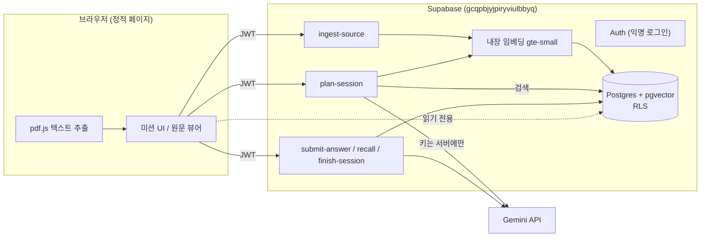

# ReadMate 웹앱 설계

작성일: 2026-11-05 · 상태: 초안 (M1 구현 완료, 나머지는 설계)

## 1. 현재 상태와 목표

**현재**: `index.html` 하나로 된 데모(v0.4). 브라우저가 PDF를 읽고(pdf.js), 청킹하고, LLM을 직접 호출한다.
LLM은 Claude 아티팩트의 `sample` 기능이나, 사용자가 입력한 Gemini 키(브라우저에서 직접 호출)로 돌린다.
판정 로직(발췌 검증, 복붙 감지, 안내 수준 조절)과 이벤트 로그도 전부 클라이언트에 있다.

**목표**: 같은 학습 흐름(읽기 지도 → 미션·피드백 → 인출 → 마무리)을 유지하면서 아래 문제를 해결하는 웹앱.

| 문제 | 설계 결정 |
|---|---|
| LLM 키가 브라우저에 노출됨 | LLM 호출을 Supabase Edge Function으로 옮기고 키는 비밀값(secrets)으로만 둔다 |
| 판정 기준(key_points)이 클라이언트 메모리에 있음 | 별도 테이블(`mission_secrets`)에 두고 service role만 읽게 한다 |
| 클라이언트가 만든 로그를 믿어야 함 | 로그를 서버가 기록·집계한다 (`events`, `turns`, `sessions.summary`) |
| 자료가 길면 LLM 한 번이 후보 문단 추리기에 쓰임 | 임베딩 검색으로 후보를 줄인다 (LLM 호출 1회 절감) |
| A/B 비교에서 문항 흐름이 달라짐 (안내 수준·질문 깊이 적응) | 실험 모드 플래그로 두 적응 기능을 끈다 |
| 연구 데이터 동의·보관 범위가 불명확함 | 동의 2종(요약 저장 / 답변 원문 저장)을 세션 단위로 기록하고 서버가 강제한다 |

## 2. 구성



- 클라이언트는 DB를 **읽기만** 한다. 모든 쓰기는 Edge Function(service role)이 한다. (RLS에 쓰기 정책이 없다.)
- 사용자는 익명 로그인(Auth)으로 구분한다. 계정 가입 없이 본인 세션만 읽을 수 있다.
- 클라이언트는 정적 페이지로 두어 무료 호스팅을 유지한다. 데모의 약 1,100줄 스크립트는 ES 모듈로 나눈다(`api`, `state`, `ui/*`). 번들러는 쓰지 않는다.

## 3. 데이터 흐름

1. **자료 올리기**: 브라우저가 PDF에서 섹션별 텍스트를 추출해 `ingest-source`에 보낸다.
   서버가 문단 단위(문장 3개 또는 300자)로 청킹하고, 청크별 임베딩을 계산해 `sources`·`chunks`에 저장한다.
2. **읽기 지도 만들기**: `plan-session`은 **A 기준으로 계획을 한 번만** 만들고, B는 그 계획에 앞뒤 청크만 더한다.
   - 질문 세트: 과제 안내문을 임베딩해 상위 16개 청크를 찾고, LLM이 요구 항목·미션(핵심 청크 하나 안의 1~3문장)·질문 변형을 만들며, 서버(`cleanPlan`)가 검증한다.
     **실험 모드(효과성 검증)**에서는 (자료, 과제 안내문)마다 한 번만 만들어 `question_sets`에 저장하고 A/B 세션이 모두 같은 세트를 쓴다.
     **그 밖(사용성 테스트)**에서는 세션마다 새로 만들고 저장하지 않는다. 과제 요구 항목은 `sessions.config.reqs`에 남긴다.
   - 조건 B: 미션마다 핵심 청크의 같은 절 안 앞 1개·뒤 1개를 붙인다(`contextIds`). 질문·판정 기준은 A와 같다.
   - **근거 범위(`basis`)**: 질문이 답할 수 있어야 하고 판정·힌트·복붙 감지·인출이 기준으로 삼는 텍스트다. 사용성 테스트(실험 모드 아님, 조건 B)는 `chunk`(고른 문장이 속한 핵심 청크 전체), 그 밖(효과성 검증, 조건 A)은 `excerpt`(고른 1~3문장)다. 실험 모드는 A/B가 같은 질문 세트와 같은 기준을 써야 하므로 항상 `excerpt`다. 앞뒤 청크는 어느 쪽에서도 근거가 아니고 `used_context` 판단에만 쓴다. 값은 `sessions.config.basis`에 남는다.
   - 세션마다 `missions`(학생에게 보임, 제공 청크 `context_ids` 포함)와 `mission_secrets`(판정 기준)로 나눠 저장한다.
3. **미션 진행** (`submit-answer`, 프롬프트 v0.5 1-5·1-6절): 미션은 순서대로만 진행한다.
   - 힌트는 학생이 요청할 때만 준다(`action: 'hint'`). 자동으로 주지 않는다. 한 번에 한 단계씩 1(볼 관점) → 2(위치 + 원문 인용 1~2문장, 인용문은 서버가 원문에서 꺼냄) → 3(대비 구조 설명). 정답 문장은 쓰지 않고, 판정 기준을 그대로 담은 힌트는 서버가 걸러 대체 문구로 바꾼다.
   - 답을 내면(`action: 'answer'`) 서버가 복붙을 감지하고(`isCopy`, 핵심 발췌와 비교), 아니면 LLM이 key_points로 pass/partial/fail을 판정한다.
   - 보완은 미션당 1회. 첫 답이 pass가 아니면 맞은 부분 + 빠진 한 가지 + 다시 확인할 위치를 안내한다(정답은 안 알려 줌). 보완 답도 pass가 아니면 핵심 요점을 보여 주고 미해결로 넘어간다. 첫 답이 pass면 보완을 요청하지 않는다. 힌트 횟수와 보완 횟수는 따로 센다. 복붙으로 다시 쓰게 한 것은 보완으로 세지 않는다.
   - 답과 함께 `evidence`(학생이 원문에서 고른 근거 문장 번호, 최대 5개, 선택)를 보내면 기록하고 응답에 되돌려 준다. 판정에는 쓰지 않는다. `evidence_cited`는 AI 판단 또는 선택이 있으면 true다.
   - 질문 신고(`report-question`): `weird`(이 질문이 이상해요) / `unanswerable`(답할 수 없어요) / `mismatch`(원문과 달라요) / `too_easy`(너무 쉬워요)를 `events`에 기록한다. 진행에는 영향이 없고, 답변 저장에 동의한 경우에만 `note`를 남긴다.
   - 판정·복붙 감지는 조건(A/B)과 무관하게 **핵심 발췌 + key_points**만으로 한다. 조건 B에서만 앞뒤 맥락을 LLM에 따로 보여 주지만 `used_context`(로그의 context_used) 판단에만 쓴다.
   - 상태는 따로 저장하지 않고 `turns` 기록에서 되살린다(`missionState`). 각 답변 기록에 `evidence_cited`, `used_context`, 판정, 결과가 들어간다. 답변 원문은 동의한 경우에만 남는다.
   - 미션이 끝나면(통과 또는 미해결) 응답의 `next_support`로 다음 미션의 안내 수준·질문 깊이·질문 유형을 돌려준다. 첫 미션의 값은 `plan-session` 응답의 `start_support`다. 서버가 앞선 미션 기록에서 처음부터 다시 계산한다(`supportBefore`). 실험 모드에서는 고정이다.

     | 도움 정도 | 해당 | 다음 미션 |
     |---|---|---|
     | 없음 | 힌트 0, 안내 요청 없음, 보완 없음 | 안내 −1(최소 0), 깊이 +1(최대 2) |
     | 조금 | 힌트 1단계, 안내 요청, **보완 받음** | 그대로 |
     | 많이 | 힌트 2단계 이상, **미해결** | 안내 +1(최대 2), 깊이 −1(최소 0) |

     시작은 안내 수준 2(읽기 전 안내 + 답변 틀), 깊이 0(이해). 질문 유형은 깊이에 가장 가까운 유형(같은 거리면 깊은 쪽)이고, 적응 모드의 마지막 미션은 최소 추론이다. 적응하지 않는 모드는 깊이 1로 고정한다. 안내 요청(`cueAsked`)은 서버에 기록이 없어 아직 반영하지 않는다.
4. **인출·예측** (`recall`, 프롬프트 v0.5 2절, Figma 흐름): 모든 미션이 끝난 뒤 **통과한 미션 전체**를 통합해 확인한다. 순서는 `start`(안내, 예측 선택지) → `predict`(4지선다 0.125/0.375/0.625/0.875, 쓰기 전에 받음) → `submit`(원문을 보지 않고 기억나는 대로 쓴 글). `skip`은 어느 단계에서든 가능하다.
   - 채점 범위는 통과한 미션의 key_points(근거 범위 안의 내용)뿐이다. 미해결 미션은 핵심을 이미 보여 줬으므로 제외한다. 조건 B의 앞뒤 청크는 쓰지 않는다(`new_info_in_recall`은 항상 false).
   - AI는 미션을 가로질러 이어 붙인 핵심 번호 중 떠올린 번호만 돌려주고, 서버가 미션별·전체 맞은 수(`tallyRecall`), 실제 비율, 예측과의 차이(`calibrate`, ±0.25)를 계산한다. 판정을 못 받으면(LLM 오류) 기록하지 않고 같은 글을 다시 낼 수 있다.
   - **한 번 쓰면 끝이다.** 빠진 핵심 문장을 보여 주지 않고, 원문과 비교해 고쳐 쓰게 하지도 않으며, 맞고 틀림을 글에 표시하지 않는다. 학생 피드백("완전한 답을 낼 때까지 계속 다듬게 해서 답답함", "갑자기 새로운 내용이 나옴")을 반영했다. 응답은 맞은 수와 예측 비교뿐이다.
   - **연결 제안(선택)** (`connect`, 프롬프트 v0.5 3절): 인출이 끝나거나 건너뛴 뒤, 통과한 미션이 2개 이상일 때만 "앞에서 읽은 개념과 사례를 과제에서 어떻게 이어 볼 수 있을까요?"를 한 번 제안한다(`start`). 학생이 쓰면(`submit`) 연결 문장을 대신 쓰지 않고, 그 연결이 어느 미션의 어떤 근거에 기대는지 원문에서 다시 찾아보게 묻는 한두 문장만 돌려준다. 건너뛰기(`skip`)가 가능하고 종료의 조건이 아니다. 기록은 `turns.kind = 'connect'`(마이그레이션 `20261118000000_turns_connect.sql`), 요약에는 `connection`(answered / skipped / none)으로 남는다. 학생 피드백(과제의 개념·사례·시사점이 앞 미션과 이어지지 않고 각각 추천됨)을 반영했다.
5. **종료** (`finish-session`, 프롬프트 v0.5 4절): 입력은 `reading_load`(1~5)와 중간 종료일 때의 `exit_reason`뿐이다. 서버가 `turns`에서 미션별 기록을 모아(`missionRecords`) v0.5 요약(`summarize`)을 만들어 `sessions.summary`에 저장하고 세션을 닫는다. 정상 종료는 미션과 인출이 모두 끝난(또는 건너뛴) 뒤에만 된다.
   - `text_units_provided`는 `missions.context_ids`의 길이다. B에서 절 경계 때문에 앞뒤 청크가 모자란 미션은 `context_boundary`에 true로 남겨, 분석에서 따로 보거나 뺄 수 있다.
   - `evidence_count`는 미션별로 학생이 고른 근거 문장 수(마지막 답 기준), `question_reports`는 미션별 질문 신고 사유 배열이다.
   - 시작하지 않은 미션은 요약에서 빠지고, 끝나지 않은 채 종료한 미션은 미해결로 센다. 인출을 하지 않았으면 예측·실제·보정은 null이다.
   - `self_corrections`: 보완한 답이 통과한 미션(`미션 N 보완`). 인출에서는 고쳐 쓰기가 없으므로 세지 않는다.
   - 확인이 필요한 값: `activity_type`은 질문 유형에서 정한 대응(이해→근거 문장 찾기, 추론→생략된 의미 추론하기, 평가→주장과 근거 구분하기)이지 실제 활동을 판정한 값이 아니다. `context_sufficient`는 계획 단계에서 근거 범위(`basis`) 안에서 답할 수 있는 질문만 남기므로 true로 채우며 별도로 점검한 값이 아니다.
   - 같은 요청을 다시 보내면 저장된 요약을 돌려준다. 요약은 연구 동의와 관계없이 본인 세션에 저장되고, 연구자용 `research_summaries` 뷰는 동의한 세션만 보여 준다.

## 4. 데이터 모델

마이그레이션: `supabase/migrations/20261105000000_init.sql`, `20261117000000_question_sets.sql`(질문 세트·공유 자료·제공 청크), `20261118000000_turns_connect.sql`(turns.kind에 connect)

| 테이블 | 용도 | 클라이언트 접근 |
|---|---|---|
| `sources` | 올린 자료(제목, 언어, 쪽수). `shared`면 소유자가 아니어도 plan-session에서 쓸 수 있다 | 본인 것만 읽기 |
| `chunks` | 청크, 문장 배열, 임베딩(384차원, HNSW 인덱스) | 본인 자료만 읽기 |
| `question_sets` | 논문·과제별로 고정된 A 기준 계획(미션·질문·판정 기준). 과제 안내문은 해시만 저장 | **접근 불가** (service role 전용) |
| `sessions` | 조건(A/B), 실험 모드, 동의 2종, 설정, 질문 세트 id, 종료 요약 | 본인 것만 읽기 |
| `missions` | 핵심 발췌 위치(picks, A 기준), 제공 청크(`context_ids`), 질문 변형(판정 기준 제외) | 본인 세션만 읽기 |
| `mission_secrets` | 질문 변형별 key_points | **접근 불가** (service role 전용) |
| `turns` | 답변·힌트·인출 기록. 답변 원문은 `consent_answers`일 때만 | 본인 세션만 읽기 |
| `events` | 서버 이벤트 로그 (데모의 `log()`에 해당) | 본인 세션만 읽기 |
| `research_summaries` (뷰) | 동의한 세션의 요약 | 연구자가 service role로 조회 |

`match_chunks(source, query, k)`가 코사인 거리로 상위 k개를 돌려준다.

## 5. 데모 → 서버 이식 지도

| 데모(index.html) | 이식 위치 | 상태 |
|---|---|---|
| `split`, `buildChunks` | `_shared/core.ts` | 완료·테스트 |
| `resolve`, `validateQuote`, `isCopy` | `_shared/core.ts` | 완료·테스트 |
| `cleanPlan` | `_shared/core.ts` (A 기준: 미션당 핵심 청크 하나, 1~3문장) | 완료·테스트 |
| 조건 B 확장(앞뒤 청크), 발췌 해석 | `_shared/core.ts` `contextIds`, `resolveExcerpts` | 완료·테스트 |
| `fadeAfter` | `_shared/core.ts` `nextSupport` (+ `EXPERIMENT_FLOW`) | 완료·테스트 |
| 보정 판정(`S.calib`) | `_shared/core.ts` `calibrate` (±0.25, 예측 − 실제) | 완료·테스트 |
| `summary()` | `_shared/core.ts` `summarize` (eval 스키마와 같은 출력) | 완료·테스트 |
| `gemCall`, `parseJson` | `_shared/llm.ts` | 완료 (호출 자체는 미검증) |
| `RULES`, `planLive` 프롬프트 | `_shared/prompts.ts` | 완료 |
| `prefilter` (LLM으로 후보 추리기) | `plan-session`의 임베딩 검색 | 완료 |
| `startLive`, `planLive` | `plan-session` (질문 세트 생성·재사용 포함) | 완료 (타입 검사만, 실행 미검증) |
| 업로드·청킹(`pdfRead`, `textChunks`) | 추출은 클라이언트, 청킹·저장은 `ingest-source` | 완료 (미검증) |
| `submit`, 힌트, `failMission` | `submit-answer` (데모와 달리 힌트는 요청 시에만, 보완은 1회) | 완료 (타입 검사만, 실행 미검증) |
| `startRecall`, `submitRecall` | `recall` (예측 → 통합 쓰기, 핵심 번호로 채점. 원문 비교·고쳐 쓰기는 뺌) | 완료 (타입 검사만, 실행 미검증) |
| `summary`의 저장 | `finish-session` | 완료 (타입 검사만, 실행 미검증) |
| 기록 패널 | 클라이언트 | M2 |
| `claimStage`, `outlineStep`(과제 지원) | 별도 함수 | M3 이후, 범위 결정 필요 |

## 6. 실험 모드 (A/B 비교)

`sessions.experiment_mode = true`이면 다음이 적용된다.

- `config`: `{ fade: false, adaptDepth: false }` → 안내 수준은 계속 2, 질문 깊이는 미션별로 고정.
- 조건 A = 발췌형(핵심 청크 안 1~3문장), 조건 B = 맥락형(핵심 청크 + 같은 절의 앞 1개 + 뒤 1개). 데모의 `ex`/`cx`에 대응한다.
- 종료 로그는 `summarize`가 만들고, `eval/checks/check_log.js`가 같은 규칙으로 검사한다. (테스트로 연결해 두었다.)

**반영된 결정 (2026-11-17)**

1. 문항 생성 **(2026-11-17 결정)**: 사용성 테스트에서는 참가자마다 과제·자료가 달라 질문을 고정하지 않는다. 세션마다 AI가 생성하고 서버가 검증한다(현재 `plan-session` 그대로). 사용성 테스트에서는 B(핵심 + 앞뒤 1개)만 쓰고 A/B 비교는 하지 않는다. 이후 효과성 검증 단계(프롬프트 행동 비교)에서 같은 논문·같은 질문으로 A/B를 비교할 때만 질문 세트를 고정한다(A 기준 1회 생성 후 저장·재사용, `QUESTION_SET`). 그때를 위해 계획을 저장·재사용할 수 있는 DB 구조(`question_sets`)는 유지한다. 이해도 효과는 사람 대상 후속 과제로 둔다.
   - 구현: `plan-session`은 `experiment`(실험 모드)일 때만 질문 세트를 `question_sets`에 저장·재사용하고, 그 밖(사용성 테스트)에서는 세션마다 새로 생성하며 저장하지 않는다. 과제 요구 항목은 `sessions.config.reqs`에 남긴다.
   - 세트를 고정할 때(효과성 검증): 사람이 쓰지 않는다. AI가 (자료, 과제 안내문)마다 **A 기준 입력**으로 1회 생성해 `question_sets`에 저장하고, A/B 세션이 같은 세트를 쓴다. 동시에 첫 요청이 둘 와도 unique 제약으로 세트는 하나만 남는다. 팀은 검토만 한다(체크 항목: A 텍스트만으로 답할 수 있는가, 판정 기준이 핵심 청크 안에 있는가). 검토는 SQL 편집기로 `question_sets.plan`을 읽어서 한다. 아직 "검토 완료" 표시나 수정 도구는 없다.
   - 같은 논문을 여러 참가자가 읽을 때 세트를 논문 단위로 유지하려면 자료를 공유해야 한다. 연구자가 SQL 편집기에서 `update sources set shared = true where id = '...'`로 표시한다. (참가자 각자가 같은 PDF를 올리면 세트가 참가자별로 따로 생긴다.)
   - 세트는 `(source_id, 과제 안내문 해시)`로 찾는다. 과제 안내문을 바꾸면 새 세트가 만들어진다. `fast`(미션 2개)는 별도 세트다.
2. 분량 단위: 단위는 청크. A = 핵심 청크 안 1~3문장, B = 핵심 청크 전체 + 앞 1개 + 뒤 1개(최대 청크 3개, 약 9문장). 문장 상한 `cxSent = 8`은 폐기했고 코드(`CONFIG.coreSent`, `MAX_TEXT_UNITS`)와 eval 프롬프트 기본값을 청크 기준으로 바꿨다. 로그의 `text_units_provided`는 미션에 제공한 청크 수다(A는 1, B는 1~3).
   - 앞뒤 청크는 **같은 절(`sec`) 안에서만** 붙인다. 절의 첫·끝 청크는 한쪽만 붙으므로 B의 일부 미션은 청크가 2개다. 절 경계를 넘으면 이어지는 논리 단위가 아니라고 보았다. 이 규칙은 문서에 없던 구현상의 판단이므로 팀이 확인해야 한다.
   - 근거는 배민령·이병민(2018)의 "짧은 지문 + 원문 문단 1~2개"이며 글자·단어 수 근거는 없다. 실험 중 예외(절 전체 제공)는 허용하지 않는다. 파일럿에서 B의 읽기 부담이 A보다 1점 이상 높거나 미션 완료율이 떨어지면 `CONFIG.ctxAfter = 0`으로 "앞 1개만"으로 줄인다.
   - 앱의 청크는 실제 문단이 아니므로(문장 3개 또는 300자 단위), 보고서에는 "청크 ±1 ≈ 문단 1~2개"로 명시하거나 업로드 시 원문 문단 경계를 살린다.

**아직 정해지지 않은 것**

1. 일반 모드(조건 없이 LLM이 읽기 유형을 판단)는 `plan-session`이 지원하지 않는다. 조건(A/B)이 필수다.
2. B 학생에게 핵심 문장(`focus`)을 표시할지 여부(UI 결정). 서버는 B의 핵심 청크에 `focus: [from, to]`를 내려 준다.

## 7. 임베딩 설계

- 모델: Supabase Edge Runtime 내장 `gte-small` (384차원). 외부 키와 호출 비용이 없다.
- 청킹은 문단(문장 묶음) 단위. 질의는 학생 답변이 아니라 **과제 안내문**이다.
- A/B가 같은 검색 결과를 쓰고, B만 앞뒤 청크를 더한다 → 변인이 텍스트 제공 방식 하나로 유지된다.
- 한계 1: 이 모델은 영어 중심이다. 교재가 영어면 문제없지만 **한국어 자료**에는 검색 품질이 떨어질 수 있다. 한국어를 다룰 때는 다국어 모델로 바꾸고, `chunks.embedding`과 `match_chunks`의 차원을 함께 바꾸는 마이그레이션이 필요하다. (모델 선택은 확인 후 결정)
- 한계 2: 구조·추론형 질문(관점이 바뀌는 지점 등)은 관련 문단이 멀리 흩어져 있어 유사도 검색이 놓칠 수 있다. 이런 미션은 해당 절 전체를 주는 규칙을 유지한다.
- 검증 방법: 질문 세트를 만들 때 정답 근거 청크 ID를 라벨링해 두고, 검색 결과(상위 16개)에 포함되는지 확인한다. (재현율 점검)

## 8. 보안·개인정보

- RLS: 모든 테이블에 켜 두고 본인 데이터 읽기 정책만 만들었다. 쓰기 정책은 없고, `anon`/`authenticated`의 쓰기 권한도 회수했다.
- service role 함수는 RLS를 우회하므로 호출 때마다 접근 권한을 직접 확인한다: 자료 소유자이거나 `sources.shared`인 자료만 쓴다. (`plan-session`에 구현)
- `question_sets.plan`에는 판정 기준(key_points)이 있으므로 `mission_secrets`처럼 클라이언트 접근을 전부 막았다.
- 비밀값: `GEMINI_API_KEY`, `GEMINI_MODEL`은 `supabase secrets`로만 설정한다. 저장소에 두지 않는다. (`.gitignore`에 `.env` 포함)
- 동의 2종: `consent_research`(횟수·점수 요약 익명 저장), `consent_answers`(답변 원문 저장). 후자가 아니면 답변 원문과 과제 안내문을 저장하지 않는다.
- 외부 LLM 전송: 자료와 답변이 Gemini로 전송된다. **학습 조항 포함 여부를 동의서에 쓰고 IRB 담당자에게 확인**하기로 한 기존 결정이 이 구조에도 그대로 적용된다.

## 9. 비용

- 임베딩: 내장 모델이라 0원. 논문당 한 번만 계산한다.
- LLM: 읽기 지도 1회 + 미션별 판정·인출 판정. 데모의 prefilter 호출이 없어져 세션당 1회 줄어든다.
- 시행 규모(30회 × 미션 3)에서 Supabase 무료 플랜(DB 용량, Edge Function 호출)과 Gemini 무료 한도에 걸리는지는 **직접 확인이 필요하다.** 이 문서의 수치로 가정하지 않는다.

## 10. 연결 방법 (Supabase 프로젝트 `gcqpbjyjpiryviulbbyq`)

이 저장소 작업에서는 Supabase 프로젝트에 아무것도 적용하지 않았다. 아래는 본인 컴퓨터에서 실행한다.

```bash
npx supabase login
npx supabase link --project-ref gcqpbjyjpiryviulbbyq
npx supabase db push                                   # 마이그레이션 적용 (init + question_sets 두 파일)
npx supabase secrets set GEMINI_API_KEY=... GEMINI_MODEL=...   # 값은 터미널에서 직접 입력. 커밋 금지
npx supabase functions deploy ingest-source plan-session submit-answer report-question recall connect finish-session
```

- Auth 설정에서 **Anonymous sign-ins**를 켜야 한다.
- `db push` 전에 확인할 것: pgvector 확장이 `extensions` 스키마에 만들어지는지, `vector(384)` 타입이 해석되는지. (SQL 문법만 검증했고 실제 DB에는 아직 적용하지 않았다.)

## 11. 검증 현황

| 대상 | 방법 | 결과 |
|---|---|---|
| 핵심 로직 | `node --test supabase/functions/_shared/core.test.ts` | 28건 통과 (A 기준 계획 검증, B 확장, 발췌 해석, 미션 상태·보완·힌트 규칙, 인출 상태·대상 선택, 요약 조립, 요약 로그가 eval 검사기 통과) |
| 로그 검사기 | `cd eval && node --test test/check_log.test.js` | 16건 통과 |
| 기록-재생 평가 | `cd eval && npx promptfoo@latest eval -c promptfooconfig.yaml --no-cache` | 파일럿 2건 통과, 잘못된 로그는 FAIL 확인 |
| Edge Function 타입 | `deno check` | 통과 |
| 마이그레이션 | SQL 구문 분석(pglast), 두 파일 | 통과 (DB 적용은 미실시) |
| Edge Function 실행 | — | **미검증** (임베딩 모델, Gemini 호출, DB 쓰기는 배포 환경에서 확인 필요) |

## 12. 마일스톤

| 단계 | 내용 |
|---|---|
| M1 (이번) | 스키마, 핵심 로직, `ingest-source`, `plan-session`, 평가 세트 |
| M2 | `submit-answer`(복붙 감지, 판정, 힌트 사다리), `recall`, `finish-session`(함수는 완료), 클라이언트 모듈화 |
| M3 | 실험 모드 완성: 질문 세트 고정, 조건 B 분량 규칙, 시행 로그 자동 수집 → `eval/runs` 연결 |
| M4 | 배포 점검: 무료 한도, 동의서·IRB, 한국어 임베딩 모델 여부 |

## 13. 열린 질문

1. (결정) 사용성 테스트: 세션마다 AI 생성 + 서버 검증, B만 사용. 효과성 검증 단계에서만 `QUESTION_SET`을 AI 1회 생성 후 고정(팀은 검토만). 효과성 검증용 기각 기준은 시작 전에 적는다.
2. (확정·반영) 분량 상한 단위는 청크, B = 핵심 + 앞뒤 1개. (6절)
3. 임베딩을 영어 모델로 갈지, 한국어 대응 모델로 바꿀지? (교재가 영어라면 현재 설정으로 시작 가능)
4. 세션 로그의 `prompt_version`: 앱이 만든 로그에도 `v0.5-chat`을 쓰는 것이 맞는가, 별도 표기(`v0.5-app`)가 나은가? (현재는 eval 검사기와 맞추기 위해 `v0.5-chat`)
