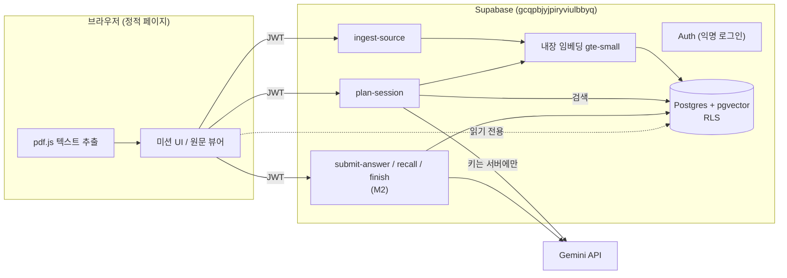

# ReadMate 웹앱 설계

작성일: 2026-11-05 · 상태: 초안 (M1 구현 완료, 나머지는 설계)

## 1. 현재 상태와 목표

**현재**: `index.html` 하나로 된 데모(v0.4). 브라우저가 PDF를 읽고(pdf.js), 청킹하고, LLM을 직접 호출한다.
LLM은 Claude 아티팩트의 `sample` 기능이나, 사용자가 입력한 Gemini 키(브라우저에서 직접 호출)로 돌린다.
판정 로직(발췌 검증, 복붙 감지, 안내 수준 조절)과 이벤트 로그도 전부 클라이언트에 있다.

**목표**: 같은 학습 흐름(읽기 지도 → 미션·피드백 → 인출 → 마무리)을 유지하면서 아래 문제를 해결하는 웹앱.

| 문제 | 설계 결정 |
|---|---|
| LLM 키가 브라우저에 노출됨 | LLM 호출을 Supabase Edge Function으로 옮기고 키는 비밀값(secrets)으로만 둔다 |
| 판정 기준(key_points)이 클라이언트 메모리에 있음 | 별도 테이블(`mission_secrets`)에 두고 service role만 읽게 한다 |
| 클라이언트가 만든 로그를 믿어야 함 | 로그를 서버가 기록·집계한다 (`events`, `turns`, `sessions.summary`) |
| 자료가 길면 LLM 한 번이 후보 문단 추리기에 쓰임 | 임베딩 검색으로 후보를 줄인다 (LLM 호출 1회 절감) |
| A/B 비교에서 문항 흐름이 달라짐 (안내 수준·질문 깊이 적응) | 실험 모드 플래그로 두 적응 기능을 끈다 |
| 연구 데이터 동의·보관 범위가 불명확함 | 동의 2종(요약 저장 / 답변 원문 저장)을 세션 단위로 기록하고 서버가 강제한다 |

## 2. 구성



- 클라이언트는 DB를 **읽기만** 한다. 모든 쓰기는 Edge Function(service role)이 한다. (RLS에 쓰기 정책이 없다.)
- 사용자는 익명 로그인(Auth)으로 구분한다. 계정 가입 없이 본인 세션만 읽을 수 있다.
- 클라이언트는 정적 페이지로 두어 무료 호스팅을 유지한다. 데모의 약 1,100줄 스크립트는 ES 모듈로 나눈다(`api`, `state`, `ui/*`). 번들러는 쓰지 않는다.

## 3. 데이터 흐름

1. **자료 올리기**: 브라우저가 PDF에서 섹션별 텍스트를 추출해 `ingest-source`에 보낸다.
   서버가 문단 단위(문장 3개 또는 300자)로 청킹하고, 청크별 임베딩을 계산해 `sources`·`chunks`에 저장한다.
2. **읽기 지도 만들기**: `plan-session`이 과제 안내문을 임베딩해 상위 16개 청크를 찾는다.
   조건 B는 앞뒤 청크(`idx ± 1`)를 후보에 더한다. LLM이 요구 항목·미션·질문 변형을 만들고, 서버(`cleanPlan`)가 검증한다.
   검증을 통과한 계획만 `missions`(학생에게 보임)와 `mission_secrets`(판정 기준)로 나눠 저장한다.
3. **미션 진행** (M2): 답변 제출 시 서버가 복붙을 감지하고(`isCopy`), 판정 기준으로 LLM이 평가한다. 힌트는 단계별로 서버가 내려 준다.
   미션이 끝나면 `nextSupport`로 다음 안내 수준·질문 깊이를 정한다. (실험 모드에서는 고정)
4. **인출·예측** (M2): 예측은 4지선다(0.125/0.375/0.625/0.875). 서버가 떠올린 핵심 수를 집계하고 `calibrate`로 판정한다.
5. **종료** (M2): `summarize`가 v0.5 로그를 만들어 `sessions.summary`에 저장한다. 동의가 없으면 과제 안내문을 비운다.

## 4. 데이터 모델

마이그레이션: `supabase/migrations/20261105000000_init.sql`

| 테이블 | 용도 | 클라이언트 접근 |
|---|---|---|
| `sources` | 올린 자료(제목, 언어, 쪽수) | 본인 것만 읽기 |
| `chunks` | 청크, 문장 배열, 임베딩(384차원, HNSW 인덱스) | 본인 자료만 읽기 |
| `sessions` | 조건(A/B), 실험 모드, 동의 2종, 설정, 종료 요약 | 본인 것만 읽기 |
| `missions` | 발췌 위치(picks), 질문 변형(판정 기준 제외) | 본인 세션만 읽기 |
| `mission_secrets` | 질문 변형별 key_points | **접근 불가** (service role 전용) |
| `turns` | 답변·힌트·인출 기록. 답변 원문은 `consent_answers`일 때만 | 본인 세션만 읽기 |
| `events` | 서버 이벤트 로그 (데모의 `log()`에 해당) | 본인 세션만 읽기 |
| `research_summaries` (뷰) | 동의한 세션의 요약 | 연구자가 service role로 조회 |

`match_chunks(source, query, k)`가 코사인 거리로 상위 k개를 돌려준다.

## 5. 데모 → 서버 이식 지도

| 데모(index.html) | 이식 위치 | 상태 |
|---|---|---|
| `split`, `buildChunks` | `_shared/core.ts` | 완료·테스트 |
| `resolve`, `validateQuote`, `isCopy` | `_shared/core.ts` | 완료·테스트 |
| `cleanPlan` | `_shared/core.ts` (조건 A/B별 문장 상한) | 완료·테스트 |
| `fadeAfter` | `_shared/core.ts` `nextSupport` (+ `EXPERIMENT_FLOW`) | 완료·테스트 |
| 보정 판정(`S.calib`) | `_shared/core.ts` `calibrate` (±0.25, 예측 − 실제) | 완료·테스트 |
| `summary()` | `_shared/core.ts` `summarize` (eval 스키마와 같은 출력) | 완료·테스트 |
| `gemCall`, `parseJson` | `_shared/llm.ts` | 완료 (호출 자체는 미검증) |
| `RULES`, `planLive` 프롬프트 | `_shared/prompts.ts` | 완료 |
| `prefilter` (LLM으로 후보 추리기) | `plan-session`의 임베딩 검색 | 완료 |
| `startLive`, `planLive` | `plan-session` | 완료 (미검증) |
| 업로드·청킹(`pdfRead`, `textChunks`) | 추출은 클라이언트, 청킹·저장은 `ingest-source` | 완료 (미검증) |
| `submit`, 힌트, `failMission` | `submit-answer` | M2 |
| `startRecall`, `submitRecall` | `recall` | M2 |
| `summary`의 저장, 기록 패널 | `finish-session` + 클라이언트 | M2 |
| `claimStage`, `outlineStep`(과제 지원) | 별도 함수 | M3 이후, 범위 결정 필요 |

## 6. 실험 모드 (A/B 비교)

`sessions.experiment_mode = true`이면 다음이 적용된다.

- `config`: `{ fade: false, adaptDepth: false }` → 안내 수준은 계속 2, 질문 깊이는 미션별로 고정.
- 조건 A = 발췌형(미션당 최대 3문장), 조건 B = 맥락형(핵심 + 앞뒤 문단). 데모의 `ex`/`cx`에 대응한다.
- 종료 로그는 `summarize`가 만들고, `eval/checks/check_log.js`가 같은 규칙으로 검사한다. (테스트로 연결해 두었다.)

**아직 정해지지 않은 것 (M3에서 결정)**

1. 문항 고정: 지금은 LLM이 질문을 만든다. A/B 문항 흐름을 같게 하려면 논문별 질문 세트를 미리 만들어 두고 `plan-session`이 그것을 입력으로 받아야 한다. (`QUESTION_SET`)
2. 분량 단위: 청크는 최대 3문장 정도라서 핵심 + 앞 + 뒤 = 최대 9문장이다. 현재 맥락형 상한 `cxSent = 8`(문장)은 이를 다 담지 못할 수 있다. 상한을 문장이 아니라 청크로 둘지 결정해야 한다. (프롬프트의 `MAX_TEXT_UNITS`와 같은 문제)
3. 일반 모드(조건 없이 LLM이 읽기 유형을 판단)는 지금 `plan-session`이 지원하지 않는다. 조건(A/B)이 필수다.

## 7. 임베딩 설계

- 모델: Supabase Edge Runtime 내장 `gte-small` (384차원). 외부 키와 호출 비용이 없다.
- 청킹은 문단(문장 묶음) 단위. 질의는 학생 답변이 아니라 **과제 안내문**이다.
- A/B가 같은 검색 결과를 쓰고, B만 앞뒤 청크를 더한다 → 변인이 텍스트 제공 방식 하나로 유지된다.
- 한계 1: 이 모델은 영어 중심이다. 교재가 영어면 문제없지만 **한국어 자료**에는 검색 품질이 떨어질 수 있다. 한국어를 다룰 때는 다국어 모델로 바꾸고, `chunks.embedding`과 `match_chunks`의 차원을 함께 바꾸는 마이그레이션이 필요하다. (모델 선택은 확인 후 결정)
- 한계 2: 구조·추론형 질문(관점이 바뀌는 지점 등)은 관련 문단이 멀리 흩어져 있어 유사도 검색이 놓칠 수 있다. 이런 미션은 해당 절 전체를 주는 규칙을 유지한다.
- 검증 방법: 질문 세트를 만들 때 정답 근거 청크 ID를 라벨링해 두고, 검색 결과(상위 16개)에 포함되는지 확인한다. (재현율 점검)

## 8. 보안·개인정보

- RLS: 모든 테이블에 켜 두고 본인 데이터 읽기 정책만 만들었다. 쓰기 정책은 없고, `anon`/`authenticated`의 쓰기 권한도 회수했다.
- service role 함수는 RLS를 우회하므로 호출 때마다 자료 소유자를 직접 확인한다. (`plan-session`에 구현)
- 비밀값: `GEMINI_API_KEY`, `GEMINI_MODEL`은 `supabase secrets`로만 설정한다. 저장소에 두지 않는다. (`.gitignore`에 `.env` 포함)
- 동의 2종: `consent_research`(횟수·점수 요약 익명 저장), `consent_answers`(답변 원문 저장). 후자가 아니면 답변 원문과 과제 안내문을 저장하지 않는다.
- 외부 LLM 전송: 자료와 답변이 Gemini로 전송된다. **학습 조항 포함 여부를 동의서에 쓰고 IRB 담당자에게 확인**하기로 한 기존 결정이 이 구조에도 그대로 적용된다.

## 9. 비용

- 임베딩: 내장 모델이라 0원. 논문당 한 번만 계산한다.
- LLM: 읽기 지도 1회 + 미션별 판정·인출 판정. 데모의 prefilter 호출이 없어져 세션당 1회 줄어든다.
- 시행 규모(30회 × 미션 3)에서 Supabase 무료 플랜(DB 용량, Edge Function 호출)과 Gemini 무료 한도에 걸리는지는 **직접 확인이 필요하다.** 이 문서의 수치로 가정하지 않는다.

## 10. 연결 방법 (Supabase 프로젝트 `gcqpbjyjpiryviulbbyq`)

이 저장소 작업에서는 Supabase 프로젝트에 아무것도 적용하지 않았다. 아래는 본인 컴퓨터에서 실행한다.

```bash
npx supabase login
npx supabase link --project-ref gcqpbjyjpiryviulbbyq
npx supabase db push                                   # 마이그레이션 적용
npx supabase secrets set GEMINI_API_KEY=... GEMINI_MODEL=...   # 값은 터미널에서 직접 입력. 커밋 금지
npx supabase functions deploy ingest-source plan-session
```

- Auth 설정에서 **Anonymous sign-ins**를 켜야 한다.
- `db push` 전에 확인할 것: pgvector 확장이 `extensions` 스키마에 만들어지는지, `vector(384)` 타입이 해석되는지. (SQL 문법만 검증했고 실제 DB에는 아직 적용하지 않았다.)

## 11. 검증 현황

| 대상 | 방법 | 결과 |
|---|---|---|
| 핵심 로직 | `node --test supabase/functions/_shared/core.test.ts` | 9건 통과 (요약 로그가 eval 검사기 통과) |
| 로그 검사기 | `cd eval && node --test test/check_log.test.js` | 16건 통과 |
| 기록-재생 평가 | `cd eval && npx promptfoo@latest eval -c promptfooconfig.yaml --no-cache` | 파일럿 2건 통과, 잘못된 로그는 FAIL 확인 |
| Edge Function 타입 | `deno check` | 통과 |
| 마이그레이션 | SQL 구문 분석(pglast) | 통과 (DB 적용은 미실시) |
| Edge Function 실행 | — | **미검증** (임베딩 모델, Gemini 호출, DB 쓰기는 배포 환경에서 확인 필요) |

## 12. 마일스톤

| 단계 | 내용 |
|---|---|
| M1 (이번) | 스키마, 핵심 로직, `ingest-source`, `plan-session`, 평가 세트 |
| M2 | `submit-answer`(복붙 감지, 판정, 힌트 사다리), `recall`, `finish-session`, 클라이언트 모듈화 |
| M3 | 실험 모드 완성: 질문 세트 고정, 조건 B 분량 규칙, 시행 로그 자동 수집 → `eval/runs` 연결 |
| M4 | 배포 점검: 무료 한도, 동의서·IRB, 한국어 임베딩 모델 여부 |

## 13. 열린 질문

1. 질문 세트(`QUESTION_SET`)는 누가, 어떤 기준으로 만드는가? (논문 5편 기준, 정답 근거 청크 라벨링 포함)
2. 분량 상한의 단위는 문장인가 청크인가? (6절)
3. 임베딩을 영어 모델로 갈지, 한국어 대응 모델로 바꿀지? (교재가 영어라면 현재 설정으로 시작 가능)
4. 세션 로그의 `prompt_version`: 앱이 만든 로그에도 `v0.5-chat`을 쓰는 것이 맞는가, 별도 표기(`v0.5-app`)가 나은가? (현재는 eval 검사기와 맞추기 위해 `v0.5-chat`)
